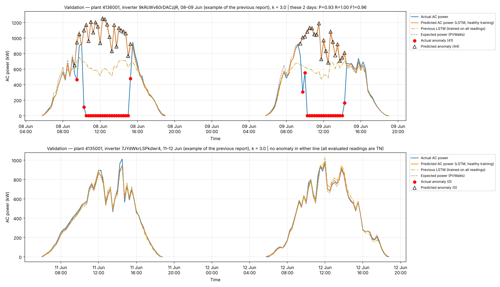
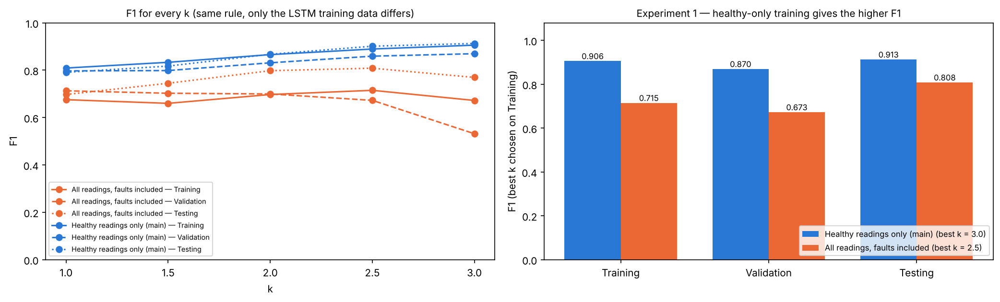
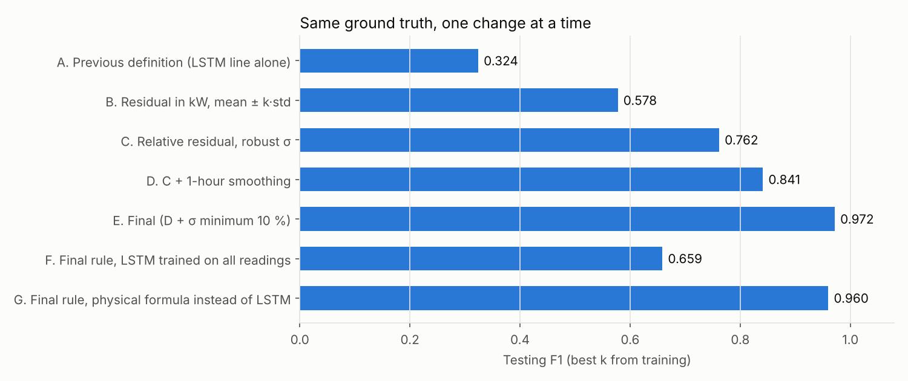
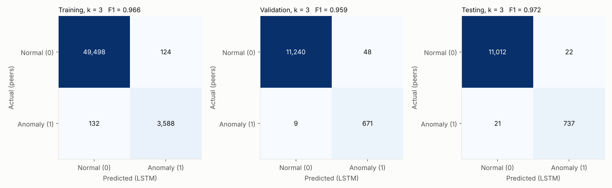
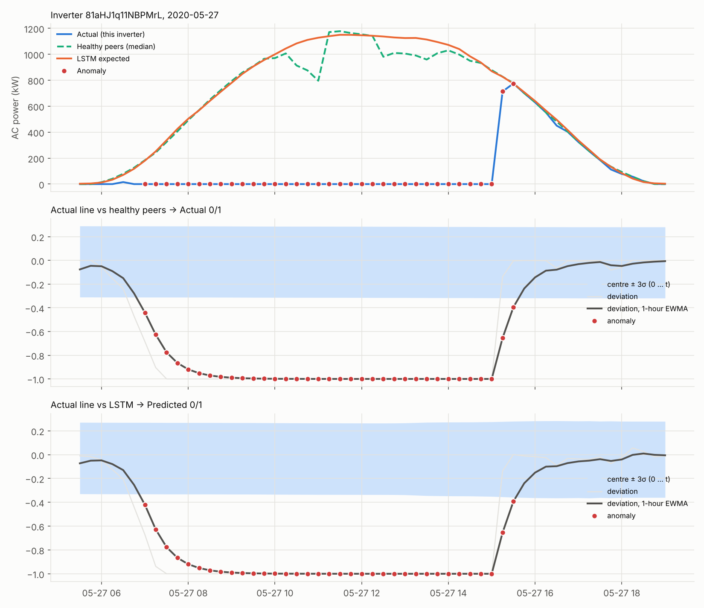

# SUNSHIELD — LSTM anomaly detection for solar inverters

SUNSHIELD finds abnormal behaviour of the 44 inverters of two solar plants (Kaggle *Solar Power Generation Data*,
15-minute readings, 15 May – 17 June 2020), following **Dr. Mai's workflow**: 70 / 15 / 15 split → LSTM predicted line →
anomaly definition with k = 1, 1.5, 2, 2.5, 3 → F1 and confusion matrix per k on training → best k → final test with that k.

## v2 (current) — `notebooks/v2/`

v2 is built on the colleague's TARGET_SHIFT = 0 notebooks. **Preprocessing, the window (48 = 12 h), the LSTM, the k values,
the plots and the six final files are kept.** Two things change, each from published research:

1. **Anomaly = actual − expected power, outside μ ± kσ** (μ = median, σ = 1.4826·MAD per inverter, training days only).
   *Actual 0/1*: expected = physical PVWatts power (irradiation + module temperature). *Predicted 0/1*: expected = LSTM line.
   Readings with irradiation < 0.2 kW/m² are not evaluated.
2. **The LSTM is trained on healthy readings only** (normal-behaviour model); an experiment compares it with training on all readings.

| Document | What |
|---|---|
| [`docs/v2/SUNSHIELD_v2_additions_and_references.pdf`](docs/v2/SUNSHIELD_v2_additions_and_references.pdf) | English: what was added, why, the research behind each step, all results |
| [`docs/v2/SUNSHIELD_v2_workflow_diagrams.pdf`](docs/v2/SUNSHIELD_v2_workflow_diagrams.pdf) | Diagrams: training, testing, the anomaly rule, the experiment, before → after, notebook map (PNG pages in `docs/v2/diagrams/`) |

### How to run

Run `notebooks/v2/1_…` to `5_…` in order. Locally (`pip install -r requirements.txt`) each notebook reads the previous one's
outputs from `outputs/`; on Colab upload the 4 CSV files to Notebook 1 and the `stepN_outputs.zip` of the previous notebook
when asked. Notebook 2 trains 7 small LSTMs (window experiment + 2 final models), about 20 minutes on a CPU.
`notebooks/v2/app.py` is the Streamlit dashboard (unzip `final_outputs.zip` next to it as `final_outputs/`).

### Results (Version A, best k = 3 chosen on training)

| Split | TP | FP | FN | TN | Precision | Recall | **F1** |
|---|---:|---:|---:|---:|---:|---:|---:|
| Training | 3,423 | 653 | 58 | 20,036 | 0.840 | 0.983 | **0.906** |
| Validation | 825 | 245 | 2 | 6,386 | 0.771 | 0.998 | **0.870** |
| Testing | 798 | 138 | 14 | 5,980 | 0.853 | 0.983 | **0.913** |

- Per plant (test): plant 4135001 F1 0.733 (only 110 anomalous readings), plant 4136001 F1 0.946.
- Independent check: of 455 test readings where an inverter gives ≤ 5 % of its neighbours' power, the LSTM flags 454.
- Fault events found on the test days: 221 of 231 (all 37 events of 1 hour or more).

**Experiment — train with faults or without?** (same rule, same readings; each model's best k from training)

| LSTM trained on | best k | Train F1 | Val F1 | **Test F1** |
|---|---:|---:|---:|---:|
| Healthy readings only (v2) | 3 | 0.906 | 0.870 | **0.913** |
| All readings, faults included (previous) | 2.5 | 0.715 | 0.673 | **0.808** |

**Why the previous rules gave a low F1** (test days, 455 outage readings):

| Rule | test F1 | outages in ground truth | found by LSTM line |
|---|---:|---:|---:|
| Change from the previous reading (each line alone) | 0.732 | 40 | 130 |
| Usual power at this time of day (each line alone) | 0.593 | 401 | 178 |
| v2: actual − expected power | 0.913 | 455 | 454 |




### v2 files

```
notebooks/v2/        1_data_preprocessing … 5_Plots_FinalFiles (executed), app.py
results/v2/plots/    all plots (1–8 of Notebook 5, experiment, window, loss, healthy readings)
results/v2/tables/   F1 for every k, best-k results, per plant, experiments, sensitivity, μ/σ limits, settings
results/v2/models/   the two LSTMs (healthy-trained = main, all-data = experiment)
results/v2/final_files.zip   the six final CSV files + metrics_per_inverter.csv (for app.py)
docs/v2/             the English document and the diagrams (rebuilt from outputs/ by the scripts in docs/v2/build/)
```

### References (v2)

Malhotra et al. 2015 (ESANN) · Hundman et al. 2018 (KDD, arXiv:1802.04431) · De Benedetti et al. 2018 (Neurocomputing 310) ·
Garoudja et al. 2017 (Solar Energy 150) · Harrou et al. 2018 (Renewable Energy 116) · Dobos 2014 (PVWatts v5, NREL/TP-6A20-62641) ·
RdTools (NREL) · Leys et al. 2013 (J. Exp. Soc. Psychol. 49) · Zhao et al. 2013 (IEEE APEC) · Chesterman et al. 2023 (Wind Energy Science 8) ·
Iyengar et al. 2018 (SolarClique, COMPASS). Full list in the English document.

---

## Earlier version — single notebook `notebooks/SUNSHIELD.ipynb`

The section below describes the earlier rebuild (peer-median reference, window 8). It is kept for reference; v2 above is
the version built on the colleague's notebooks.

SUNSHIELD finds abnormal behaviour of the 44 inverters of two solar plants (Kaggle *Solar Power Generation
Data*, 15-minute readings, 15 May – 17 June 2020). An LSTM learns how much power a **healthy** inverter produces
under the current weather; an inverter that produces clearly more or less than that is an anomaly.

It follows **Dr. Mai's workflow**: 70 / 15 / 15 split → LSTM predicted line → anomaly definition with
k = 1, 1.5, 2, 2.5, 3 → F1 and confusion matrix per k on training → best k → final test with that k.

### How to run

Everything is in **one notebook**: `notebooks/SUNSHIELD.ipynb`.

- **Google Colab:** open the notebook, *Runtime → Run all*, and upload the 4 CSV files when asked
  (`Plant_1_Generation_Data.csv`, `Plant_1_Weather_Sensor_Data.csv`, `Plant_2_Generation_Data.csv`,
  `Plant_2_Weather_Sensor_Data.csv`, also in `data/raw/`). At the end it downloads `SUNSHIELD_results.zip`.
- **Locally:** `pip install -r requirements.txt`, open the notebook from the `notebooks` folder and run all;
  it reads the CSV files from `data/raw/`.

It takes about 30–40 minutes on a CPU (Part 2 trains 14 small networks, Part 5 trains 6 more; set
`RUN_COMPARISON = False` to skip Part 5). Results go to `outputs/`.

### Results

Best k chosen on **training only**: **k = 3** (training F1 0.966). LSTM window: 8 readings (2 hours).

| Split | TP | FP | FN | TN | Precision | Recall | **F1** |
|---|---:|---:|---:|---:|---:|---:|---:|
| Training | 3,588 | 124 | 132 | 49,498 | 0.967 | 0.965 | **0.966** |
| Validation | 671 | 48 | 9 | 11,240 | 0.933 | 0.987 | **0.959** |
| **Testing (final)** | 737 | 22 | 21 | 11,012 | 0.971 | 0.972 | **0.972** |

- Per plant (test): Plant 1 F1 0.985 (only 34 anomalous readings), Plant 2 F1 0.971.
- Fault events (consecutive anomalous readings of one inverter) found on the test days: **105 of 109**.
- LSTM error on healthy test readings: RMSE 44 kW (Plant 1) and 45 kW (Plant 2), about 3 % of capacity.

**What each change contributes** (Part 5: same ground truth, best k on training for each):

| Detector (Predicted 0/1) | best k | Validation F1 | **Test F1** |
|---|---:|---:|---:|
| A. Previous definition, applied to the LSTM line alone | 1.0 | 0.280 | **0.324** |
| B. Residual actual − LSTM in kW, mean ± k·std | 1.5 | 0.582 | **0.578** |
| C. Relative residual, robust σ (median / MAD) | 3.0 | 0.735 | **0.762** |
| D. C + 1-hour smoothing | 3.0 | 0.806 | **0.841** |
| **E. Final: D + σ never below 10 %** | **3.0** | **0.959** | **0.972** |
| F. Final rule, but LSTM trained on all readings (faults included) | 3.0 | 0.662 | **0.659** |
| G. Final rule, physical formula instead of the LSTM | 2.5 | 0.959 | **0.960** |

- Training the LSTM on healthy readings only matters: with faults in its training targets, test F1 falls to 0.659.
- The previous ground truth (change rule on the actual line) held only **6–12 %** of the outage readings
  (228–453 of about 3,800), so the earlier F1 of about 0.70–0.73 is not comparable with these numbers.





### Method in short

The method, with the research behind each step, is explained (in Arabic) in `docs/SUNSHIELD_method.pdf` / `docs/SUNSHIELD_method.docx`.

| Step | What | Why |
|---|---|---|
| Expected power, ground truth | median of the **other** 21 inverters of the plant at the same moment; physical PV formula when the whole plant is down | Inverters share the sky (Performance-to-Peers, Leloux et al. 2014; IEA-PVPS T13 2017) |
| Expected power, model | LSTM from 2 h of weather + time of day (sin/cos), trained on **healthy** readings only | Normal-behaviour model (Malhotra et al. 2015; Chesterman et al. 2023) |
| Deviation | (actual − expected) / max(expected, 20 % of capacity) | −1 = produced nothing, at any hour |
| Smoothing | 1-hour EWMA, past readings only | A cloud lasts minutes, a fault hours (Hundman et al. 2018) |
| Threshold | expanding median ± k·σ from reading 0 to t, σ = max(1.4826·MAD, 10 %) | Faults do not inflate median / MAD (Leys et al. 2013) |
| Actual 0/1 / Predicted 0/1 | the same rule with the peers / with the LSTM as expected power | Does the LSTM find what the neighbours reveal? |

### Limitations

- The ground truth is measured (healthy neighbours), not hand-labelled; no operator log was available.
- σ is never below 10 %, so at k = 3 a gap must be roughly ≥ 30 % to count; small slow losses are out of scope.
  The 10 % is a tolerance, not tuned by F1 (a larger value always raises F1; Part 5 shows the trade-off).
- Plant 1 has very few anomalies, so its per-plant scores rest on small numbers.
- The physical formula comes close to the LSTM (Part 5); most of the gain comes from the corrected definition.
- 34 days of one season; thresholds and models should be re-fitted with more data.
- The 1-hour smoothing adds a short lag at the start and end of an event (the same for both lines).

### Repository

```
data/raw/                  the 4 Kaggle CSV files
notebooks/SUNSHIELD.ipynb  the whole pipeline (Parts 1–5)
results/                   final tables, figures and final_files.zip (the 6 result files)
docs/                      method document (Arabic, PDF and Word) + short English summary of the additions and references
```

### References

1. Malhotra, P., Vig, L., Shroff, G., Agarwal, P. (2015). Long Short Term Memory Networks for Anomaly Detection in Time Series. ESANN.
2. Hundman, K. et al. (2018). Detecting Spacecraft Anomalies Using LSTMs and Nonparametric Dynamic Thresholding. KDD. arXiv:1802.04431.
3. Leys, C. et al. (2013). Detecting outliers: Do not use standard deviation around the mean, use absolute deviation around the median. J. Exp. Soc. Psychol. 49(4), 764–766.
4. Chesterman, X. et al. (2023). Overview of normal behavior modeling approaches for SCADA-based wind turbine condition monitoring. Wind Energy Science 8, 893–924.
5. Leloux, J. et al. (2014). Automatic fault detection on BIPV systems without solar irradiation data. EU PVSEC. arXiv:1410.6946.
6. IEA-PVPS Task 13 (2017). Improving Efficiency of PV Systems Using Statistical Performance Monitoring. T13-07:2017.
7. Dobos, A. P. (2014). PVWatts Version 5 Manual. NREL/TP-6A20-62641.
8. Harrou, F. et al. (2018). Reliable fault detection and diagnosis of photovoltaic systems based on statistical monitoring approaches. Renewable Energy 116, 22–37.
9. Kim, S. et al. (2022). Towards a Rigorous Evaluation of Time-Series Anomaly Detection. AAAI.
10. Rousseeuw, P. J. (1984). Least Median of Squares Regression. JASA 79(388).
