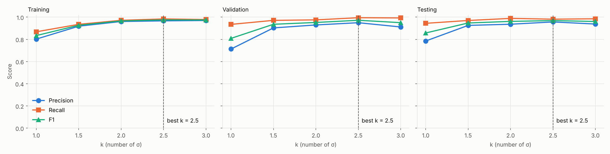

# SUNSHIELD — LSTM anomaly detection for solar inverters

SUNSHIELD finds abnormal behaviour of the 44 inverters of two Indian solar plants (Kaggle *Solar Power
Generation Data*, 15-minute readings, 15 May – 17 June 2020). An LSTM learns how much power a **healthy**
inverter produces under the current weather; an inverter that produces clearly more or less than that is an
anomaly.

This version is a complete rebuild. It keeps **Dr. Mai's workflow** (70 / 15 / 15 split → LSTM predicted line →
anomaly definition with k = 1, 1.5, 2, 2.5, 3 → F1 and confusion matrix per σ on training → best σ → final
test with that σ), but rebuilds the LSTM and redefines the anomaly.

## Results

Best σ chosen on **training only**: **k = 2.5** (training F1 0.975). Validation and test use that k unchanged.

| Split | TP | FP | FN | TN | Precision | Recall | **F1** |
|---|---:|---:|---:|---:|---:|---:|---:|
| Training | 3,826 | 133 | 63 | 49,320 | 0.966 | 0.984 | **0.975** |
| Validation | 738 | 39 | 4 | 11,187 | 0.950 | 0.995 | **0.972** |
| **Testing (final)** | 795 | 36 | 15 | 10,946 | 0.957 | 0.982 | **0.969** |

- Per plant (test): Plant 1 F1 0.972 (only 36 anomalous readings), Plant 2 F1 0.969.
- Fault events (consecutive anomalous readings of one inverter) found on the test days: **115 of 117**.
- The ground truth contains **99 %** of the big-loss readings (inverter below half of its healthy neighbours).
- LSTM error on healthy readings (test): RMSE 44 kW (Plant 1) and 53 kW (Plant 2), i.e. 3–4 % of capacity.

### What each change contributes (Notebook 5)

Every detector is scored against the **same ground truth** with the same protocol (best k on training),
changing one thing at a time:

| Detector (Predicted 0/1) | best k | Validation F1 | **Test F1** |
|---|---:|---:|---:|
| A. Previous definition, applied to the LSTM line alone | 1.0 | 0.240 | **0.290** |
| B. Residual actual − LSTM in kW, mean ± k·std | 1.5 | 0.589 | **0.612** |
| C. Normalised residual, robust σ (median / MAD) | 3.0 | 0.721 | **0.753** |
| D. C + 1-hour smoothing | 3.0 | 0.778 | **0.824** |
| **E. Final: D + σ never below 10 %** | **2.5** | **0.972** | **0.969** |
| F. Final rule, but LSTM trained on all readings (faults included) | 3.0 | 0.660 | **0.663** |
| G. Final rule, physical formula instead of the LSTM | 2.5 | 0.964 | **0.959** |

- Training the LSTM on **healthy readings only** is essential: with faults in the training targets
  (detector F), test F1 falls from 0.969 to 0.663.
- The previous ground truth (change rule on the actual line) contained only **12–34 %** of the anomalies
  found from the healthy peers, and only **242–453 of ~3,800 outage readings** (6–12 %), depending on k.
- The previous notebooks reported test F1 ≈ 0.70–0.73, but against that previous ground truth. Those
  numbers measured agreement on ordinary ups and downs, not on faults, so they are not comparable with the
  table above.
- The smoothing span and the σ minimum were chosen from training and validation results only. Notebook 5 shows that
  validation F1 stays between 0.92 and 0.97 for spans of 30–60 min and σ minimums of 7.5–15 %.




## Why the previous version scored low and missed anomalies

Checked on the data (Notebook 3 shows each check):

1. **The predicted line was the same for all 22 inverters of a plant.** The LSTM input is the plant's
   weather, and one sensor serves 22 inverters, so the spread of the predicted line between inverters at the
   same moment is ≈ 0 kW. A 0/1 computed on that line alone cannot say *which* inverter failed.
2. **Long outages got no flag.** Inverter `81aHJ1q11NBPMrL` produced 0 kW from 06:00 to 15:00 on
   2020-05-27 while its neighbours produced up to 1,200 kW. The change from one reading to the next is
   0, so the previous definition gave **0 flags** for these 37 readings, at every k, in the ground truth too.
3. **Normal sunrise and sunset ramps were flagged**, because they are the biggest changes of a normal day.
4. **Faults inflated the mean and std** that were supposed to detect them (masking; Leys et al., 2013). In
   Plant 2 about 13 % of sunny readings (irradiation > 0.1 kW/m²) are faults.

## The new anomaly definition

An anomaly is a reading where an inverter produced clearly **more (rise)** or **less (drop)** than a healthy
inverter would under the same weather, for long enough not to be a passing cloud (residual principle of
LSTM anomaly detection: Malhotra et al., 2015; Hundman et al., 2018).

For one inverter, in time order, with expected power $\hat P_t$:

| Step | Formula |
|---|---|
| Deviation | $d_t = (P_t - \hat P_t)\,/\,\max(\hat P_t,\ 0.2\,P_{cap})$ → −1 = produced nothing |
| Smoothing (1 h, past only) | $s_t = \text{EWMA}_{span=4}(d_0 \dots d_t)$ (Hundman et al., 2018) |
| Centre, expanding from 0 | $c_t = \operatorname{median}(s_0 \dots s_t)$ |
| σ, expanding from 0 | $\sigma_t = \max\big(1.4826 \cdot \operatorname{MAD}(s_0 \dots s_t),\ 0.10\big)$ (Leys et al., 2013) |
| Flag | rise if $s_t > c_t + k\sigma_t$, drop if $s_t < c_t - k\sigma_t$ |

The same rule is applied to **two lines, each alone**; only $\hat P_t$ changes:

- **Actual 0/1 (ground truth):** $\hat P_t$ = the 75th percentile of the *other* 21 inverters of the plant at
  the same moment (they share the sky; Performance-to-Peers idea, Leloux et al., 2014; IEA-PVPS T13, 2017).
  When even the peers are below half of what the irradiation allows (whole plant down), a physical PV formula
  $a\,G\,(1+\gamma(T_{mod}-25))$ is used instead. Measured data only, no model.
- **Predicted 0/1 (the model):** $\hat P_t$ = the LSTM prediction from the weather.

So the F1 answers: *does the LSTM, from the weather alone, find the abnormal readings that the measured healthy
neighbours reveal?*

## The rebuilt LSTM (normal-behaviour model)

| Previous | Now | Why |
|---|---|---|
| Trained on all readings, incl. 0 kW in full sun | Trained on **healthy** readings only | Otherwise the model learns that faults are normal and the gap shrinks (normal-behaviour modelling, Chesterman et al., 2023) |
| 3 weather inputs | 3 weather inputs + **time of day** | Sun position |
| Windows on each inverter's run (cross-night jumps, readings lost at each run start) | Windows on the **continuous** 15-min weather timeline | Every daylight reading gets a prediction |
| One model for both plants | **One model per plant** | Different sites and sensors |
| Linear output (negative power) | **Softplus** output | Power ≥ 0 |
| One network | **Average of 3 seeds** | Stability |

Window size is chosen by validation loss: 4, 8, 16, 32 and 48 readings were tested and **8 readings (2 hours)** had the lowest mean validation loss. Inputs are standardised with training statistics only.

## Repository

```
data/raw/                       the 4 Kaggle CSV files
sunshield/                      the pipeline (imported by the notebooks)
  config.py                     every setting in one place
  data.py                       loading, cleaning, split, healthy-peer reference
  model.py                      LSTM normal-behaviour model
  anomaly.py                    the anomaly definition
  evaluate.py                   F1, confusion matrix, best k
  plots.py                      chart style and shared figures
notebooks/
  01_data_preprocessing.ipynb   Dataset → Preprocessing → Split
  02_lstm_training.ipynb        LSTM → predicted line
  03_anomaly_definition.ipynb   anomaly definition → Actual 0/1, Predicted 0/1
  04_evaluation.ipynb           F1 per σ → best σ → final test + the 6 result files
  05_comparison_with_previous_method.ipynb   what each change contributes
results/                        final tables, figures and final_files.zip (the 6 result files)
```

## How to run

**Locally:** `pip install -r requirements.txt`, then run the notebooks 01 → 05 in order from the `notebooks`
folder. Each notebook saves to `outputs/stepN/` and the next one reads from there (no uploads needed).
Notebook 2 trains 14 small networks (≈ 15 min on a 4-core CPU); Notebook 5 trains 6 more (≈ 5–10 min).

**Google Colab:** put the `SUNSHIELD` folder in *My Drive* (or clone it to `/content/SUNSHIELD`) and open the
notebooks from there; the first cell finds the folder and mounts Drive if needed.

## Limitations (read before presenting the results)

- **The ground truth is measured, not hand-labelled.** It is defined by the healthy neighbours of each
  inverter. When three quarters or more of a plant's inverters fail at the same moment, it falls back to a
  physical formula. No operator log was available to confirm individual faults.
- **The σ minimum sets the resolution.** σ is never below 10 % of the expected power, so at the chosen k a gap
  must be roughly ≥ k × 10 % (≈ 25 % at k = 2.5) to count. Small, slow losses (a few % of soiling, slight
  degradation) are out of scope for a model that only sees one weather sensor per plant. A larger σ minimum
  always raises F1, because it keeps only the largest anomalies. That is why it was **not** tuned by F1
  (15 % would score higher). It is set at 10 % as a tolerance, and Notebook 5 shows the trade-off.
- **Plant 1 has very few anomalies** (its inverters are healthy almost all the time), so its per-plant scores
  rest on small numbers. Plant 2 drives the overall result.
- **The physical formula is close behind the LSTM** (Notebook 5, detector G). Most of the improvement comes
  from the corrected anomaly definition. The LSTM adds a smaller, consistent gain.
- **34 days of data, one season.** Thresholds and models should be re-fitted when more data arrives.
- The 1-hour smoothing adds a short lag: an event is flagged from its second or third reading, and stays flagged
  for one or two readings after it ends. Both lines lag in the same way, so it does not hurt the comparison.
- Scores are **point-wise** F1, as in the workflow. Event-level recall is reported next to them, not
  instead of them, and point-adjust is not used (Kim et al., 2022).

## References

1. Malhotra, P., Vig, L., Shroff, G., Agarwal, P. (2015). *Long Short Term Memory Networks for Anomaly Detection in Time Series.* ESANN 2015.
2. Hundman, K., Constantinou, V., Laporte, C., Colwell, I., Soderstrom, T. (2018). *Detecting Spacecraft Anomalies Using LSTMs and Nonparametric Dynamic Thresholding.* KDD 2018. arXiv:1802.04431.
3. Leys, C., Ley, C., Klein, O., Bernard, P., Licata, L. (2013). *Detecting outliers: Do not use standard deviation around the mean, use absolute deviation around the median.* Journal of Experimental Social Psychology 49(4), 764–766. doi:10.1016/j.jesp.2013.03.013.
4. Chesterman, X., Verstraeten, T., Daems, P.-J., Nowé, A., Helsen, J. (2023). *Overview of normal behavior modeling approaches for SCADA-based wind turbine condition monitoring demonstrated on data from operational wind farms.* Wind Energy Science 8, 893–924. doi:10.5194/wes-8-893-2023.
5. Leloux, J. et al. (2014). *Automatic fault detection on BIPV systems without solar irradiation data.* EU PVSEC 2014. arXiv:1410.6946 (Performance-to-Peers indicator).
6. IEA-PVPS Task 13 (2017). *Improving Efficiency of PV Systems Using Statistical Performance Monitoring.* Report IEA-PVPS T13-07:2017.
7. Harrou, F., Sun, Y., Taghezouit, B., Saidi, A., Hamlati, M.-E. (2018). *Reliable fault detection and diagnosis of photovoltaic systems based on statistical monitoring approaches.* Renewable Energy 116, 22–37 (EWMA charts on model residuals).
8. Kim, S., Choi, K., Choi, H.-S., Lee, B., Yoon, S. (2022). *Towards a Rigorous Evaluation of Time-Series Anomaly Detection.* AAAI 2022 (why point-adjusted F1 is not used here).
9. Ibrahim, M., Alsheikh, A., Awaysheh, F. M., Alshehri, M. D. (2022). *Machine Learning Schemes for Anomaly Detection in Solar Power Plants.* Energies 15(3), 1082 (same dataset).
